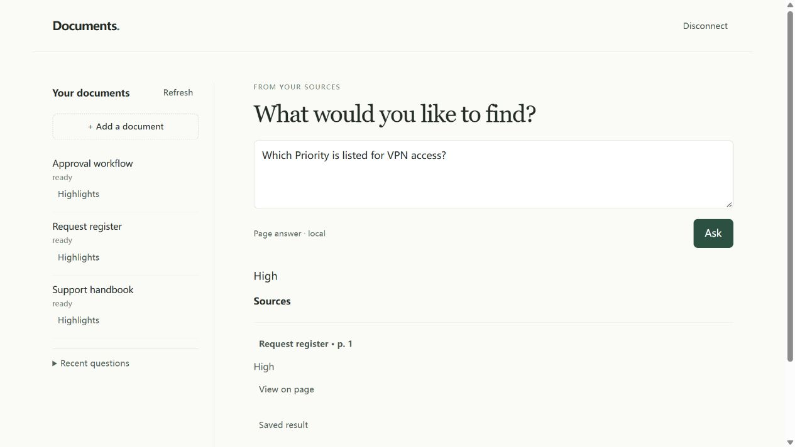

# Local Document Intelligence

Локальное приложение для работы с документами: загружайте файлы, находите информацию, задавайте поддерживаемые вопросы и проверяйте источник ответа на странице. Данные хранятся локально в SQLite.

## Как выглядит приложение



[Источник ответа в таблице](screenshots/table-source.jpg) · [Ветка согласования](screenshots/approval-source.jpg)

На скриншотах показаны синтетические заявки службы поддержки. Это действующий интерфейс и детерминированные ответы по документам, а не демонстрация качества языковой модели.

## Установка и запуск

Нужен Python 3.11 или 3.12. Для изображений страниц PDF нужен отдельно установленный Poppler (`pdftoppm`).

```powershell
python -m venv .venv
.venv/Scripts/python.exe -m pip install ".[api,pdf,pdf-tables,visual]"
```

Используйте подготовленный локальный профиль с `.env` и базой SQLite. Для первого создания профиля есть `scripts/prepare_lite.py prepare --root .`: этот helper требует Docker Compose CLI для проверки конфигурации, не запускает контейнеры и отказывается заменять существующие данные.

Скопируйте `examples/demo-config.example.json` в `demo.local.json` и укажите существующие пути. Для обычных PDF и таблиц достаточно полей `root`, `port`, `table_engine`, `renderer`. Поля `raster_config`, `ocr_tesseract`, `ocr_data` нужны только для отдельно настроенного OCR/OpenCV-режима.

```powershell
.venv/Scripts/python.exe scripts/demo.py check --config demo.local.json
.venv/Scripts/python.exe scripts/demo.py api --config demo.local.json
```

В другом терминале:

```powershell
.venv/Scripts/python.exe scripts/demo.py worker --config demo.local.json
```

Откройте http://127.0.0.1:8880/ или порт из своего конфига и введите viewer token из локального `.env`. Токены и локальные базы в архив не входят.

## Что показать за 2–3 минуты

В `examples/demo/` уже есть готовые документы: реестр заявок, порядок согласования и короткая инструкция поддержки. [Сценарий показа](examples/demo/SHOWCASE.md) содержит вопросы и ожидаемые результаты.

- `Which Priority is listed for VPN access?` → `High`.
- `Which Status is listed for VPN access?` → `Approved`.
- `View on page` показывает строку и ячейку с ответом.
- В отдельно настроенном OCR/OpenCV-режиме вопрос `Which step follows Review when Yes?` с `Find source: Request approval` возвращает `Approve`.

Для чтения загруженных документов viewer должен получить READ через API администратора. Административная роль сама по себе не заменяет READ.

## Ограничения и зависимости

Поддерживаются ограниченные шаблоны таблиц и схем. OCR и обработка растровых схем требуют внешних Tesseract/OpenCV-компонентов. Полная автоматическая установка на чистой машине, независимое качество на разных документах и промышленное масштабирование не заявляются.

Основные библиотеки: [FastAPI](https://github.com/fastapi/fastapi), [Uvicorn](https://github.com/encode/uvicorn), [pypdf](https://github.com/py-pdf/pypdf), [pdfplumber](https://github.com/jsvine/pdfplumber), [Pillow](https://github.com/python-pillow/Pillow).
